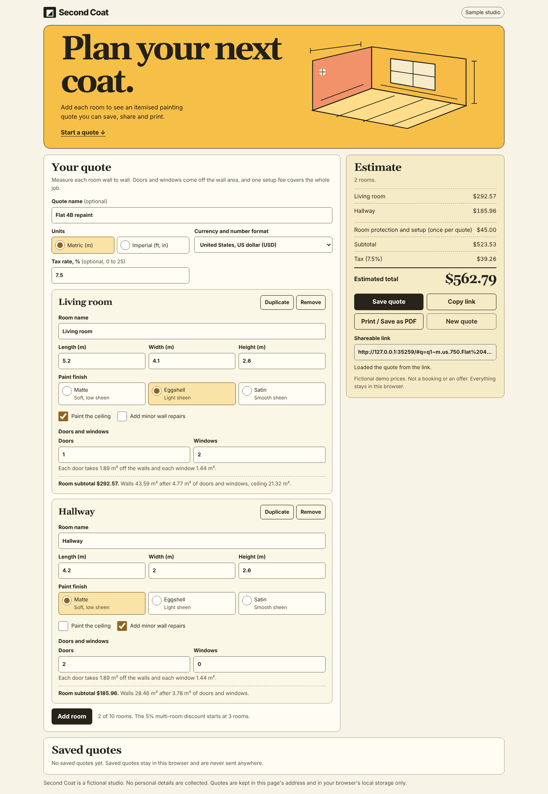
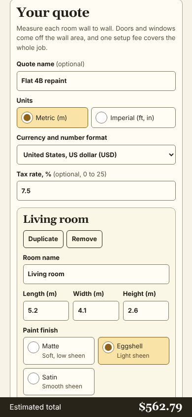
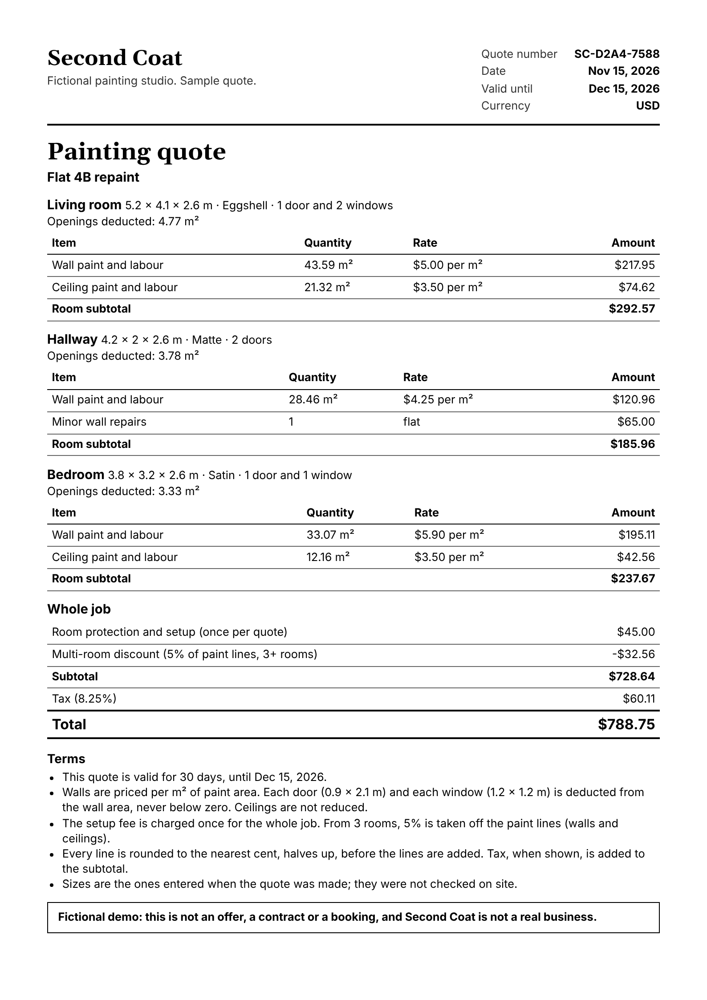
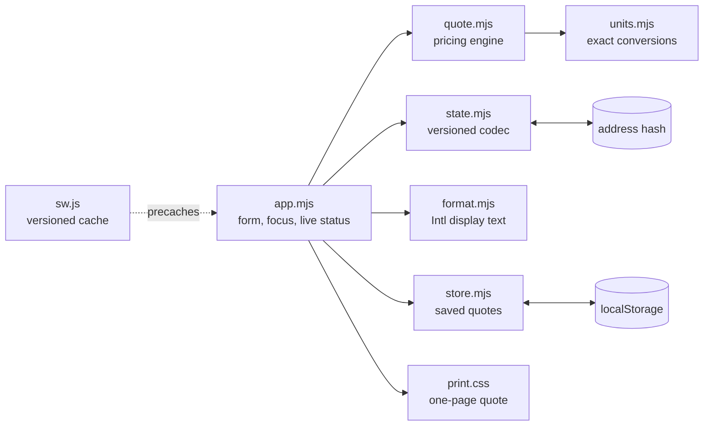

# Room Paint Estimator

A multi-room painting quote builder for a fictional studio, Second Coat. Add up to ten rooms and get an itemised quote that is exact to the cent: door and window deductions, one setup fee per job, a demo discount for three or more rooms and optional tax. Share the quote as a link, save it in the browser, print it as a one-page PDF, and keep using it with the network off. It is plain HTML, CSS and JavaScript with no framework, no runtime dependency, no build step and no request to any other site. Second Coat is a fictional studio and every price, rate and quote number here is made up.

| On a phone (390 px wide) | The printed quote (A4, three rooms) |
| --- | --- |
|  |  |

## What it demonstrates

- **Money without rounding drift.** [quote.mjs](quote.mjs) works in whole millimetres, whole square millimetres and whole cents. [units.mjs](units.mjs) reads decimal text such as `4,5` or `14 ft 9.5 in` into integers without floating point. [test/quote.test.mjs](test/quote.test.mjs) has examples worked out by hand, the edge cases (limits, openings larger than the walls, a discount or tax that lands on exactly half a cent) and 5,000 seeded random quotes compared with an independent BigInt implementation written inside the test. The first version of this project had one-cent errors from floating-point rounding; [estimate.mjs](estimate.mjs), the original single-room estimate, is now a thin wrapper over the new engine and its original tests pass unchanged.
- **Untrusted input handled strictly.** [state.mjs](state.mjs) turns a quote into a short versioned string (`q1~m.us.825.Flat%204B~...`) for the address hash and for localStorage. The decoder accepts only the exact text the encoder would write, caps the length at 4,500 characters, and never throws: [test/state.test.mjs](test/state.test.mjs) feeds it 30,000 garbage and mutated inputs and checks that whatever it accepts is valid and re-encodes to itself. A bad link falls back to a new quote and says so on the page. [store.mjs](store.mjs) re-validates everything it reads back from localStorage and skips damaged entries with a visible note.
- **A form people can use without a mouse.** [index.html](index.html) and [app.mjs](app.mjs): every control has a label, a mistake is explained next to its field (`aria-invalid`, `aria-describedby`), adding, duplicating or removing a room moves focus to a sensible place and announces the change in a polite live region, and a keyboard-only test walks the flow. Targets are at least 24 px, contrast is computed from the palette in [test/contrast.test.mjs](test/contrast.test.mjs), reduced motion is respected, and the page works at 360 px without sideways scrolling.
- **A printable quote without a PDF library.** [print.css](print.css) shows only the quote sheet that [app.mjs](app.mjs) keeps up to date: studio name, a quote number derived from the quote itself (a hash, so the same quote always has the same number), the date, 30 days of validity, an itemised table per room, totals, terms and the fictional-demo notice. The browser tests check the sheet in print emulation and count the pages of a real PDF.
- **Offline use.** [sw.js](sw.js), [manifest.webmanifest](manifest.webmanifest) and [pwa.mjs](pwa.mjs): the app shell is precached all-or-nothing, answered cache-first, and an old cache is deleted only when it belongs to this app. The cache name carries a hash of the precached files and a unit test fails when it is stale. The browser tests cut the network, reload, keep editing and restore a draft, both at the site root and under a `/room-paint-estimator/` sub-path.
- **Security basics for a static site.** A strict Content-Security-Policy in a `<meta>` tag (so it also holds on GitHub Pages, where headers cannot be set) with no inline styles or scripts; a test scans the shipped files for web addresses. [serve.mjs](serve.mjs) serves a fixed list of files, only by GET or HEAD, and keeps running when sent a malformed address.
- **Evidence over claims.** The numbers in the table further down come from scripts and are saved in [docs/evidence](docs/evidence). The tables in this README are generated from those files and from the code constants, and CI fails if they drift.

## Run it

Requires Node.js 22 or later. The app itself has nothing to install:

~~~sh
npm start        # http://127.0.0.1:4190 (set PORT to use another port)
~~~

The tests use a few dev dependencies (Playwright core, axe-core and Lighthouse). None of them is sent to the browser.

~~~sh
npm ci
npm test                                        # unit and server tests, no browser needed
CHROME_PATH=/path/to/chrome npm run test:e2e    # browser tests, including the axe checks
npm run coverage                                # line coverage gate, writes docs/evidence/coverage.txt
CHROME_PATH=/path/to/chrome npm run lighthouse  # median of 3 mobile runs, writes docs/evidence/lighthouse.json
CHROME_PATH=/path/to/chrome npm run evidence    # regenerates everything in docs/evidence and the tables below
npm run stamp                                   # after changing a precached file: refreshes the cache version in sw.js
~~~

The static app can be hosted on GitHub Pages from the repository root: every address is relative. Headings use Georgia where it is installed and the bundled Gelasio, an open typeface with Georgia's letter widths, everywhere else, so the page looks the same on every device.

## Pricing rules

Every rule below is a rule of this fictional studio. The tables are generated from the constants in [quote.mjs](quote.mjs) by [scripts/readme-evidence.mjs](scripts/readme-evidence.mjs).

<!-- rules:start -->
| Rule | In this demo |
| --- | --- |
| Rooms in a quote | 1 to 10 |
| Room size | length and width 2 to 15 m, height 2 to 5 m. Stored as whole millimetres; feet and inches are converted exactly (1 ft = 304.8 mm, 1 in = 25.4 mm), a half millimetre rounds up |
| Doors | 0 to 10 per room; each is 0.9 × 2.1 m, so 1.89 m² comes off the walls |
| Windows | 0 to 10 per room; each is 1.2 × 1.2 m, so 1.44 m² comes off the walls |
| Wall area | 2 × (length + width) × height, minus the doors and windows, never below zero (a room whose openings are larger than its walls has a wall line of 0.00) |
| Ceiling area | length × width, only when the room has its ceiling painted; doors and windows are not deducted |
| Paint lines | area × the price per m² for the finish (walls) or the ceiling price, rounded half up to a whole cent, one line at a time |
| Minor wall repairs | a flat fee for each room that has them |
| Room protection and setup | one flat fee for the whole quote, not one per room |
| Multi-room discount (a rule of this demo) | 5 % of the summed paint lines (walls and ceilings only) when the quote has 3 or more rooms, rounded half up. Repairs and the setup fee are not discounted |
| Tax | optional, 0 to 25 % in steps of 0.01 %, applied to the subtotal after the discount and rounded half up |
| Total | the rounded lines added up, minus the discount, plus the tax |

Price lists. They are fictional, and each currency has its own list; they are not exchange rates of one another.

| Item | USD (United States) | GBP (United Kingdom) | EUR (Germany, France) |
| --- | --- | --- | --- |
| Matte walls, per m² | 4.25 | 3.40 | 3.90 |
| Eggshell walls, per m² | 5.00 | 4.00 | 4.60 |
| Satin walls, per m² | 5.90 | 4.70 | 5.40 |
| Ceiling, per m² | 3.50 | 2.80 | 3.20 |
| Minor wall repairs, per room | 65.00 | 52.00 | 60.00 |
| Room protection and setup, per quote | 45.00 | 36.00 | 41.00 |
<!-- rules:end -->

## Architecture

The engine, the codec, the formatters and the store are plain modules with no access to the page, so Node tests them directly; only [app.mjs](app.mjs) touches the DOM.

| File | Role |
| --- | --- |
| [quote.mjs](quote.mjs) | Validates and prices a quote. Pure functions, integers only. |
| [units.mjs](units.mjs) | Exact conversion of metres, feet and inches, and square feet for display. |
| [state.mjs](state.mjs) | Encodes and strictly decodes a quote; the quote number. |
| [format.mjs](format.mjs) | Money, areas, lengths and dates for a locale; the text of the summary and the printed quote. |
| [store.mjs](store.mjs) | Saved quotes and the draft, with validation of what is read back. |
| [app.mjs](app.mjs) | Wires the page: rooms, errors, summary, saved quotes, print sheet, link handling. |
| [sw.js](sw.js), [pwa.mjs](pwa.mjs) | Offline cache and its registration. |
| [serve.mjs](serve.mjs) | Local server with a fixed list of files. |
| [scripts](scripts) | Evidence, icons, cache stamp and screenshot scripts. |

## Decisions

- **Integer millimetres and cents.** Floating-point arithmetic gave the first version one-cent errors, so lengths, areas and money are integers end to end, and decimal text is read into scaled integers rather than numbers. Rounding is half up, one line at a time, then the lines are added.
- **A separate price list for each currency.** The currency and number-format select changes the price list and the formatting together; the lists are fictional and are not exchange rates of one another, so no conversion step can introduce a rounding difference.
- **No framework.** The page is one form and a few lists. The DOM holds the text people typed, and a validated state is built from it on every change. That keeps the page small and lets GitHub Pages serve the repository root with no build.
- **State in the address hash.** A shared link is the whole quote and needs no server; the part of an address after `#` is never sent to a server. The price of that is a link that carries the quote's names, and a limit on its length.
- **Print CSS, not a PDF library.** The browser's own "Print / Save as PDF" produces the file, so there is no code to ship or keep up to date. The result depends on the browser's print dialog.
- **A decoder that accepts one spelling.** Because only the encoder's exact output is accepted, there is exactly one valid string for each quote, which makes the fuzz test's "accepted means canonical" check possible.
- **The cache version is a hash of the files.** A forgotten version bump is the usual way an offline app serves stale files; here a test fails instead.
- **Real-browser tests.** The flows that matter here (focus, live announcements, print, the service worker, offline) do not exist in a simulated DOM, so they run in Chromium.

## Quality evidence

Produced by [scripts/evidence.mjs](scripts/evidence.mjs) and saved in [docs/evidence](docs/evidence). The table is generated from those files.

<!-- evidence:start -->
| Check | Result | Recorded in |
| --- | --- | --- |
| Unit and server tests | 68 of 68 pass (Node v22.23.4, 2026-11-15) | [tests.json](docs/evidence/tests.json) |
| Browser tests | 20 of 20 pass (Chrome 153.0.8010.12) | [tests.json](docs/evidence/tests.json) |
| Line coverage of the unit tests | format.mjs 100.00 %, quote.mjs 100.00 %, state.mjs 100.00 %, store.mjs 100.00 %, units.mjs 100.00 %. The gate is 90 % on quote.mjs and state.mjs. Branch coverage over all five files is 99.68 % | [coverage.txt](docs/evidence/coverage.txt) |
| Accessibility, axe-core 4.14.0 (WCAG 2.0 to 2.2 A and AA, plus best practices) | 0 violations in 6 scenarios | [axe.json](docs/evidence/axe.json) |
| Lighthouse 13.6.0, mobile preset, simulated throttling, median of 3 runs | Performance 99, Accessibility 100, Best Practices 100, SEO 100 | [lighthouse.json](docs/evidence/lighthouse.json) |
| Lighthouse metrics (median) | first contentful paint 765 ms, largest contentful paint 765 ms, total blocking time 13 ms, cumulative layout shift 0.064, speed index 765 ms | [lighthouse.json](docs/evidence/lighthouse.json) |
| Printed quote | 3 rooms: 1 A4 page. 10 rooms with every option: 3 pages | [print.json](docs/evidence/print.json) |

The axe scenarios are: default quote, desktop; default quote, 360 px wide; 3-room quote with 4 errors shown; the same quote in feet and inches; saved-quotes panel with two saved quotes; print media emulation, 3-room quote.
<!-- evidence:end -->

Notes on reading it. axe lists `color-contrast` as "needs review" for one element in each scenario: the decorative `◩` mark in the header (a symbol that has no text to measure) and, in print emulation, the studio name, which axe reports as partly overlapped. The palette's contrast ratios are computed separately in [test/contrast.test.mjs](test/contrast.test.mjs), and the printed page was looked at in [docs/quote-print.png](docs/quote-print.png). The Lighthouse layout shift comes from the room cards being drawn by script after the first paint.

## Limits and next steps

- **Fictional prices.** Nothing here is a real rate card, and a quote is not an offer. Sizes are what was typed in; nothing is checked on site.
- **A simple room model.** A room is a plain box: no sloped ceilings, alcoves or partly painted walls. Doors and windows have one fixed size each. Rooms are 2 to 15 m long and wide and 2 to 5 m high, at most 10 per quote and 10 doors and windows per room.
- **A shared link is readable by anyone who has it.** It holds the whole quote, names included, in plain text, and the limit is 4,500 characters.
- **Saved quotes stay in one browser.** They live in localStorage (at most 20); clearing site data or switching browser or device loses them. There is no sync.
- **Print.** One A4 page was measured for a three-room quote and three for the largest possible quote (table above). US Letter paper was not measured. A phone's print dialog was not tried.
- **Updates reach the offline copy late.** A new version is picked up once every tab of the app has been closed; there is no "update available" prompt.
- **Chromium only.** The tests run in Chrome 153. Firefox and Safari were not tried, and the page relies on CSS `:has()`, `Intl.NumberFormat` data, localStorage and service workers.
- **CI has not run yet.** [The workflow](.github/workflows/test.yml) could not be run where this was built (no GitHub Actions, no Docker). Its commands are the ones used locally, but the first run on GitHub is the real check. Its performance gate is 90, below the local median, because shared runners are slower and noisier.
- **Lighthouse ran against a local server**, in headless Chrome with simulated throttling, not against a deployed GitHub Pages site.
- **Quote numbers are 32-bit hashes.** They are stable and fine for a demo; they are not collision-free or tamper-proof.
- **Dates and validity use the browser's clock** and time zone.
- **Switching units** keeps every valid size exactly but clears a field whose text was not a number.
- **Next:** an "update available" prompt for the offline copy, a Letter-size check, user-defined line items, and tests in Firefox and WebKit.

© 2026 muhammmmadziam1234-eng. All rights reserved, except the typeface in [fonts](fonts), which keeps its own licence.
